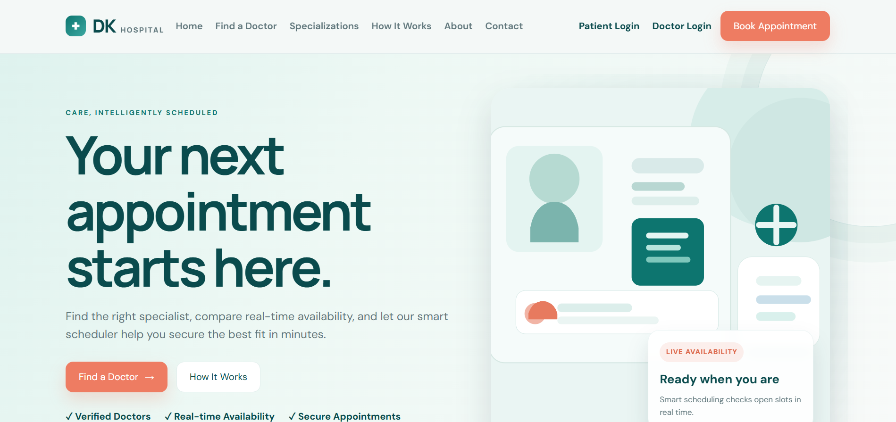
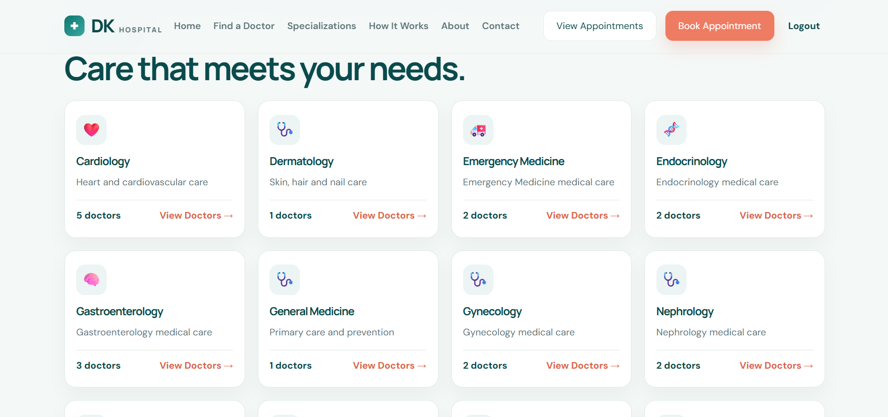
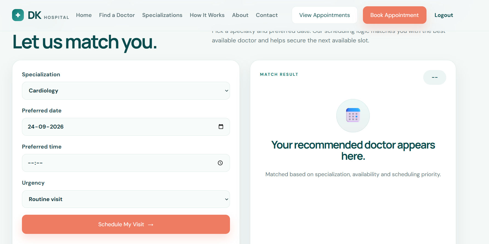
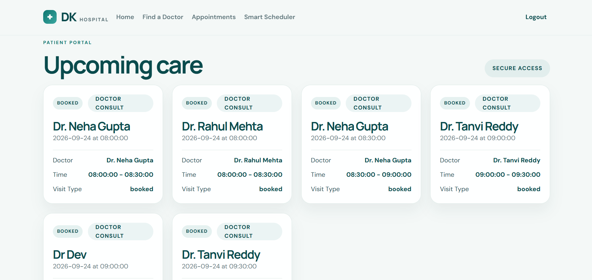
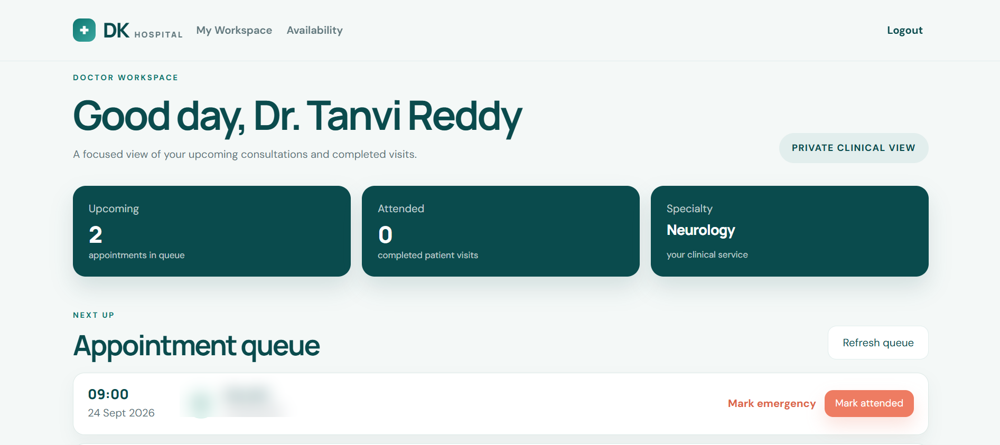
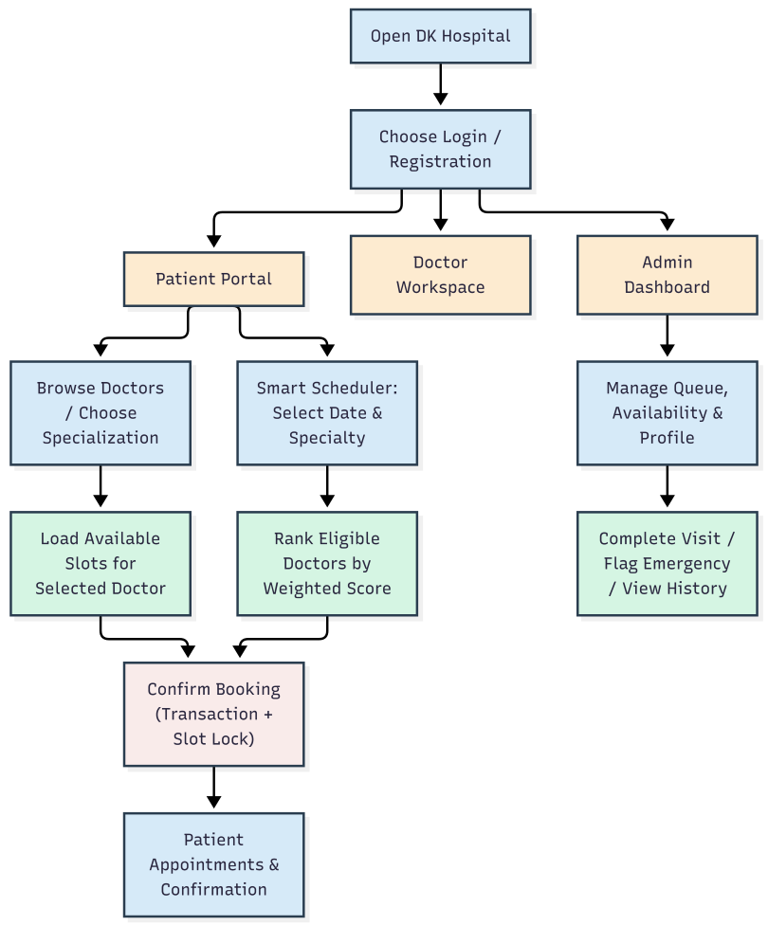
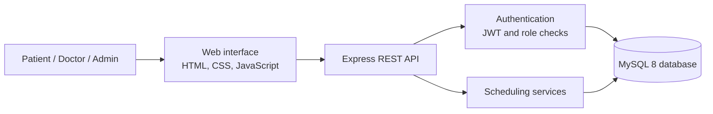

<div align="center">

# DK Hospital – Smart Doctor Scheduling System

**A web-based hospital appointment management system with rule-based doctor ranking and transactional slot booking.**

[](https://nodejs.org/)
[](https://expressjs.com/)
[](https://www.mysql.com/)
[](#license)

</div>

<p align="center">
  
</p>

## Overview

DK Hospital is a full-stack appointment scheduling application designed to make it easier for patients to find doctors and book consultation slots. Patients can browse specializations, view doctors, check available time slots, book appointments manually, or use the Smart Scheduler to receive a doctor recommendation based on availability and doctor-related factors.

The application provides separate experiences for **Patients**, **Doctors**, and **Administrators**. Doctors can manage their availability and appointment queue, while administrators can view system-level dashboard information and manage administrative workflows.

The Smart Scheduler in this project is a **weighted, rule-based ranking system**. It is not a machine-learning model and does not make clinical decisions.

## Contents

- [Key Features](#key-features)
- [Application Screenshots](#application-screenshots)
- [System Workflow](#system-workflow)
- [Smart Scheduler – Ranking Logic](#smart-scheduler--ranking-logic)
- [Technology Stack](#technology-stack)
- [Project Structure](#project-structure)
- [Database Design](#database-design)
- [Getting Started](#getting-started)
- [API Overview](#api-overview)
- [Demo Data and Development Credentials](#demo-data-and-development-credentials)
- [Security and Production Notes](#security-and-production-notes)
- [Known Scope and Limitations](#known-scope-and-limitations)

## Key Features

### Patient
- Register and sign in securely.
- Browse available medical specializations and doctors.
- View available appointment slots for a selected doctor and date.
- Book an appointment directly or use the Smart Scheduler.
- View upcoming appointments and appointment history.
- Cancel or request a reschedule for an existing appointment.

### Doctor
- Sign in to a dedicated doctor workspace.
- View upcoming appointments and the appointment queue.
- Create and update weekly availability rules.
- Mark appointments as completed.
- Flag an appointment as an emergency; flagged appointments are shown ahead of routine bookings in the doctor queue.
- View completed-visit history.

### Administrator
- Access the administrator dashboard.
- View user, doctor, and appointment summary information.
- Access administrative patient and specialization operations.

### Scheduling and booking
- Generate appointment slots using a doctor's active availability rules and configured slot duration.
- Rank eligible doctors using a weighted score.
- Attempt booking with the highest-ranked eligible doctor first.
- Use a database transaction and a unique doctor/date/start-time constraint to protect against duplicate slot bookings.

## Application Screenshots

The screenshots below show the main application views. The patient identity fields in the doctor-workspace screenshot have been blurred before inclusion in this documentation.

| Home page | Specialization directory |
|:--:|:--:|
|  |  |

| Smart Scheduler | Patient appointments |
|:--:|:--:|
|  |  |

| Doctor workspace |
|:--:|
|  |

## System Workflow

The following workflow illustrates the main patient, doctor, and administrator paths through the application.

<p align="center">
  
</p>

At a high level, the browser-based frontend communicates with the Express application through HTTP JSON endpoints. The backend applies authentication and role checks, runs scheduling and appointment logic, and reads or writes data in MySQL.



## Smart Scheduler – Ranking Logic

The scheduler first finds doctors who belong to the requested specialization and have at least one available slot on the preferred date. It then calculates a score for each eligible doctor and sorts candidates from highest to lowest score.

The current implementation uses these weighted factors:

| Factor | Weight | Purpose |
|:--|--:|:--|
| Time until the next available slot | 45% | Gives a higher score to an earlier available appointment. |
| Doctor experience | 20% | Considers years of professional experience. |
| Average doctor rating | 20% | Uses the stored rating on a five-point scale. |
| Remaining daily capacity | 15% | Favors doctors with a lighter booked workload. |

The weights are implemented in `services/rankDoctors.js`. The scheduler is deterministic for a given set of input values and stored data; it does not use trained model weights or patient diagnosis data.

## Technology Stack

| Layer | Technology / Library | Responsibility |
|:--|:--|:--|
| Frontend | HTML, CSS, JavaScript | User interface served from the `public/` directory. |
| Backend | Node.js 20+, Express 4 | HTTP server, REST endpoints, and application logic. |
| Database | MySQL 8 | Persistent storage, relational constraints, indexes, and views. |
| Database driver | `mysql2` (Promise API) | Connection pooling and parameterized SQL queries. |
| Authentication | `jsonwebtoken` | JWT creation and verification. |
| Password hashing | `bcrypt` | Hashing and verifying user passwords. |
| Security middleware | Helmet, CORS, `express-rate-limit` | HTTP security headers, cross-origin handling, and authentication-route rate limiting. |
| Testing | Jest, Supertest | Automated test runner and HTTP endpoint testing utilities. |
| Containerization | Docker, Docker Compose | Local application and MySQL startup. |

## Project Structure

```text
smart-doctor-scheduling-system/
├── database/
│   └── schema.sql                 # Tables, indexes, views, and demo seed data
├── middleware/
│   └── auth.js                    # JWT authentication and role authorization
├── public/                        # Frontend HTML, CSS, JavaScript, and static assets
├── routes/
│   └── extra.js                   # Patient, availability, booking, and dashboard routes
├── services/
│   ├── bookAppointment.js         # Transactional appointment booking
│   ├── generateSlots.js           # Available-slot generation
│   ├── rankDoctors.js             # Weighted doctor scoring
│   └── scheduleBestAvailable.js   # Smart Scheduler orchestration
├── tests/                         # Automated tests
├── .gitignore
├── Dockerfile
├── docker-compose.yml
├── db.js                          # MySQL connection pool
├── jest.config.js
├── package.json
├── package-lock.json
├── server.js                      # Express application and API routes
└── README.md
```

## Database Design

The database schema is initialized by `database/schema.sql`. Its main relational tables are:

| Table | Purpose |
|:--|:--|
| `Users` | Login identity, email, password hash, and role (`patient`, `doctor`, or `admin`). |
| `Patients` | Patient profile information linked to a user. |
| `Doctors` | Doctor profile, specialization, experience, fee, rating, and daily capacity. |
| `Specializations` | Medical specialty catalogue. |
| `Doctor_Availability` | Weekly availability rules and slot duration for each doctor. |
| `Appointments` | Patient bookings, doctor, date, time, status, and emergency flag. |

The schema also defines the `Doctor_Directory` and `Doctor_Daily_Load` views. Indexes support common doctor, availability, and appointment lookups. The `Appointments` table has a unique key on `(doctor_id, appointment_date, start_time)` so that the same doctor/time slot cannot be inserted twice.

## Getting Started

### Prerequisites

For a local installation, install:

- Node.js 20 or later and npm.
- MySQL 8.0.
- Git.

Alternatively, install Docker Desktop with Docker Compose to run the app and database together.

### Option A – Run with Docker Compose

1. Clone the repository:

   ```bash
   git clone https://github.com/Devrath66/smart-doctor-scheduling-system.git
   cd smart-doctor-scheduling-system
   ```

2. Start the application and database:

   ```bash
   docker compose up --build
   ```

3. Open the application in your browser:

   ```text
   http://localhost:3000
   ```

The MySQL container initializes the database from `database/schema.sql` on its first run. The named Docker volume keeps database data between restarts.

To stop the containers:

```bash
docker compose down
```

To remove the database volume and all local database data (use with care):

```bash
docker compose down -v
```

### Option B – Run with a local MySQL server

1. Clone the repository and install dependencies:

   ```bash
   git clone https://github.com/Devrath66/smart-doctor-scheduling-system.git
   cd smart-doctor-scheduling-system
   npm ci
   ```

2. Create a file named `.env` in the project root. The repository does not currently include an `.env.example`, so create the file with your own local database credentials:

   ```dotenv
   PORT=3000
   DB_HOST=127.0.0.1
   DB_PORT=3306
   DB_USER=root
   DB_PASSWORD=your_mysql_password
   DB_NAME=clinic_scheduler
   JWT_SECRET=replace_with_a_long_random_secret
   ```

   Change `DB_USER` and `DB_PASSWORD` to match your local MySQL setup. Do not commit `.env` to Git.

3. Initialize the database and tables:

   ```bash
   mysql -u root -p < database/schema.sql
   ```

   If you use a different MySQL username, replace `root` in the command.

4. Start the application:

   ```bash
   npm start
   ```

5. Visit `http://localhost:3000`. You can check the server health endpoint at `http://localhost:3000/api/health`.

### Run the tests

```bash
npm test
```

The test command runs Jest in serial mode (`--runInBand`). This README documents the test command configured in `package.json`; test results should be verified in your own environment before reporting a pass rate or coverage figure.

## API Overview

The backend exposes JSON-based REST endpoints. Protected endpoints require a bearer token in the `Authorization` header.

| Method | Endpoint | Purpose |
|:--|:--|:--|
| `GET` | `/api/health` | Check whether the server is responding. |
| `POST` | `/api/auth/register` | Register a patient. |
| `POST` | `/api/auth/register-doctor` | Register a doctor. |
| `POST` | `/api/auth/login` | Authenticate a user and receive a JWT. |
| `GET` | `/api/specializations` | List medical specializations. |
| `GET` | `/api/doctors` | List doctors; optionally filter with `specializationId`. |
| `GET` | `/api/availability/:doctorId/:date` | Get available slots for a doctor and date. |
| `POST` | `/api/appointments` | Book a selected doctor and slot. |
| `POST` | `/api/smart-schedule` | Run the Smart Scheduler for an authenticated patient. |
| `GET` | `/api/appointments` | List appointments visible to the signed-in role. |
| `PATCH` | `/api/appointments/:id/cancel` | Cancel an appointment when permitted. |
| `PATCH` | `/api/appointments/:id/reschedule` | Reschedule a patient appointment. |
| `POST` | `/api/availability` | Add a doctor availability rule. |
| `GET` | `/api/dashboard/doctor` | Get the signed-in doctor's dashboard data. |
| `GET` | `/api/dashboard/admin` | Get administrator summary data. |

For the full request/response behavior and authorization rules, refer to `server.js`, `routes/extra.js`, and `middleware/auth.js`.

## Demo Data and Development Credentials

The SQL schema inserts sample patient and doctor data. The existing project setup uses the password `password` for seeded patient and doctor demo accounts. The application also creates an administrator account during startup:

| Role | Email | Password |
|:--|:--|:--|
| Patient (demo) | `patient@northstar.test` | `password` |
| Doctor (example) | `arjun.sharma@dkhospital.com` | `password` |
| Administrator (demo) | `admin@northstar.test` | `Admin@123` |

**These credentials are for local demonstration only.** Do not use them on a public deployment or with real patient information. The current startup logic resets the demo administrator password when the server starts; change that bootstrap logic before using the project in a real environment.

## Security and Production Notes

This repository is a student/demo project and should be reviewed before production use. In particular:

- Set a long, unpredictable `JWT_SECRET` through environment configuration. The current code contains a development fallback secret.
- Replace the default Docker database passwords and restrict database access.
- Remove or redesign the hard-coded demo administrator bootstrap and demo accounts.
- Restrict CORS to trusted frontend origins and configure HTTPS at the deployment boundary.
- Review authorization, validation, logging, backup, and privacy requirements before handling real patient data.
- Do not commit `.env`, database passwords, real patient information, or production tokens.

The application is an appointment-management aid, not a medical diagnosis or emergency-response service. Patients with urgent symptoms should contact local emergency services or a qualified healthcare provider directly.

## Known Scope and Limitations

- The Smart Scheduler uses a configurable-in-code weighted rule formula; it is not an ML model.
- Doctor ratings and experience are stored values and are not independently verified by the application.
- The current unique key on `(doctor_id, appointment_date, start_time)` applies regardless of appointment status. As a result, a cancelled appointment can still prevent that exact slot from being booked again; the slot lifecycle and uniqueness strategy should be revised before production use.
- The current rescheduling endpoint marks the original appointment as `rescheduled` before creating the replacement booking; those two operations are not wrapped in one shared transaction. A production implementation should make rescheduling atomic.
- Performance, throughput, and test-coverage figures should only be published after running measurements in a defined environment.
- A production deployment would need stronger secret management, deployment-specific CORS policy, monitoring, backups, and a security review.

## Contributing

Contributions and suggestions are welcome. For a change, create a branch, make the update, run the relevant tests, and open a pull request with a clear description of the change.

## License

A license file is not currently included in this repository. Add a `LICENSE` file before granting others permission to reuse, modify, or distribute the project.

## Repository

Source code: [github.com/Devrath66/smart-doctor-scheduling-system](https://github.com/Devrath66/smart-doctor-scheduling-system)
